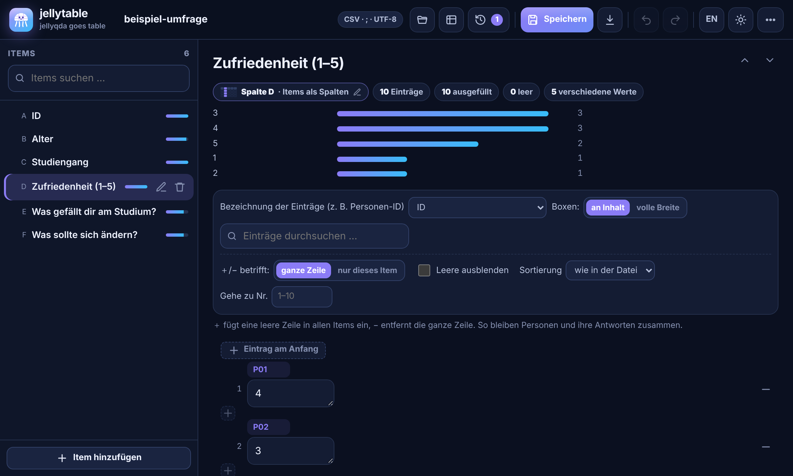
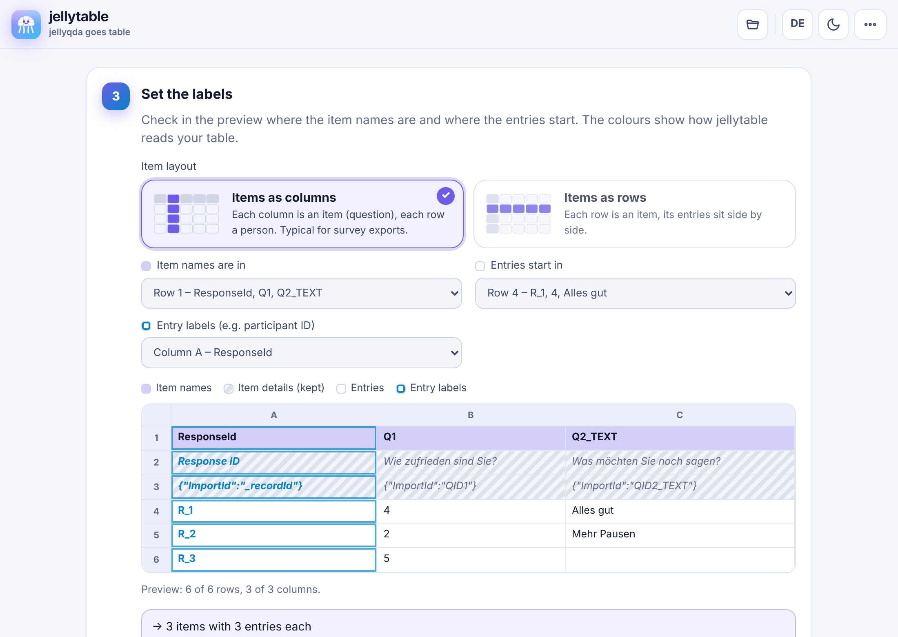

> 🌐 [English](README.md) · **Deutsch**


# jellytable

**jellyqda goes table – Umfrage-Tabellen in Ruhe durchblättern. Offline, privat, im Browser.**

Umfrage-Tools exportieren CSV- oder Excel-Dateien, die schwer zu lesen sind: dutzende Spalten, lange Freitext-Antworten in winzigen Zellen. jellytable zeigt **ein Item nach dem anderen**: links die Items (Fragen), rechts alle Einträge des gewählten Items – zum Lesen, Bearbeiten und Wieder-Speichern.



- 🔒 **Privatsphäre zuerst:** Alles passiert in deinem Browser-Tab. Kein Upload, kein Server, kein Konto, keine Cookies, kein Tracking.
- ✈️ **Funktioniert offline:** jellytable ist **eine einzige HTML-Datei** ohne Bibliotheken. Herunterladen, doppelklicken, fertig.
- 🧭 **Items als Spalten oder Zeilen:** Du legst fest, wie deine Tabelle aufgebaut ist (typischer Umfrage-Export: eine Spalte pro Frage, eine Zeile pro Person).
- 🏷️ **Du bestimmst, wo die Bezeichnungen stehen:** Eine Vorschau zeigt, in welcher Zeile (oder Spalte) die Item-Namen stehen, wo die Einträge beginnen und welche Spalte die Einträge bezeichnet (z. B. Personen-ID). Zusätzliche Kopfzeilen – etwa Fragetext und Import-IDs in Qualtrics-Exporten – bleiben als *Item-Details* erhalten und werden unverändert mit exportiert.
- 🔎 **Durchblättern:** Item-Liste mit Suche und Füllstand, Einträge mit Häufigkeiten bei geschlossenen Fragen, eine Kennung deiner Wahl (z. B. Teilnehmenden-ID) neben jedem Eintrag, Suche in den Einträgen.
- ↔️ **Angenehm lesen:** Den Rand der Item-Liste ziehen, um sie breiter oder schmaler zu machen (wird gemerkt); Eintrags-Boxen wachsen mit ihrem Inhalt (oder auf volle Breite umschalten).
- ✏️ **Bearbeiten:** Einträge und ihre Bezeichnungen ändern, **＋** fügt überall einen leeren Eintrag ein (auch am Anfang und Ende), **−** entfernt einen Eintrag – für die **ganze Zeile** (alle Items, so bleiben Personen und Antworten zusammen) oder **nur dieses Item**. Items umbenennen / hinzufügen / löschen / verschieben. Rückgängig und Wiederholen für alles.
- 🧾 **Änderungsprotokoll:** Jede Änderung steht mit Uhrzeit und vorher → nachher in einer Liste, geänderte Einträge sind markiert; das Protokoll lässt sich als CSV speichern (z. B. für den Methodenteil).
- 🧭 **Navigieren:** leere Einträge ausblenden, sortieren (A→Z, Z→A, nach Häufigkeit), zu Eintrag Nr. … springen, Strg+Enter springt zum nächsten Eintrag.
- 💾 **Speichern & Export:** Excel (`.xlsx`), OpenDocument (`.ods`), CSV (Komma, UTF-8), CSV für Excel (Semikolon, mit BOM), TSV, Excel-2003-XML, JSON – mit Items als Spalten oder Zeilen. **Weitere Tabellenblätter** einer Arbeitsmappe werden mitgespeichert (Werte). In Chrome/Edge wählst du einmal den Speicherort, danach speichert Strg+S direkt dorthin; in Firefox/Safari wird die Datei heruntergeladen.
- 🦊 **Läuft in Firefox, Chrome, Edge und Safari** – automatisch getestet in Firefox und Chromium.
- 🌙 **Hell- und Dunkelmodus**, 🌐 Oberfläche auf **Deutsch und Englisch**.

## Benutzen

- **Online:** die GitHub-Pages-Seite dieses Repos öffnen (siehe *Veröffentlichen* unten).
- **Offline:** [`index.html`](index.html) herunterladen (z. B. *Raw → Speichern unter …*) und im Browser öffnen. Mehr braucht es nicht.

Dann: **1** festlegen, ob die Items Spalten oder Zeilen sind → **2** Datei hineinziehen → **3** in der Vorschau prüfen und festlegen, wo Item-Namen, Einträge und die Bezeichnung der Einträge stehen → durchblättern. Schritt 3 lässt sich jederzeit wieder ändern: **Einrichten** in der Menüzeile, oder auf den Chip „Spalte E · Items als Spalten“ über den Einträgen klicken.



 **Speichern** (Strg+S) schreibt die Datei im ursprünglichen Format; **Exportieren** (Strg+E) lässt Format und Ausrichtung wählen. Im Browser heißt „Speichern“: Die Datei wird heruntergeladen – deine Originaldatei wird nie verändert.

### Unterstützte Formate

| | Lesen | Schreiben |
|---|---|---|
| CSV / TSV / TXT (Trennzeichen und Zeichensatz werden erkannt: UTF-8, UTF-16, Windows-1252) | ✅ | ✅ |
| Excel `.xlsx` / `.xlsm` (mehrere Blätter, Datum, Wahrheitswerte) | ✅ | ✅ `.xlsx` |
| OpenDocument `.ods` | ✅ | ✅ |
| Excel-2003-XML (SpreadsheetML) | ✅ | ✅ |
| JSON | – | ✅ |
| Altes binäres Excel `.xls` | ❌ (vorher als `.xlsx` speichern) | – |

Werte, die wie einfache Zahlen aussehen, werden als Zahl geschrieben, alles andere als Text; Datumsangaben als Text im ISO-Format (`2026-03-01`). Formeln und Formatierungen der Originaldatei bleiben nicht erhalten – jellytable arbeitet mit den Werten.

### Tastenkürzel

| Tasten | Wirkung |
|---|---|
| Strg + S | Speichern |
| Strg + E | Exportieren |
| Strg + O | Datei öffnen |
| Strg + Z / Strg + Y | Rückgängig / Wiederholen |
| Strg + Enter | Nächster Eintrag (mit Umschalt: vorheriger) |
| Alt + ↑ / ↓ | Vorheriges / nächstes Item |

Auf dem Mac jeweils Cmd statt Strg.

## Datenschutz

jellytable schickt nie Daten irgendwohin – es gibt keinen Server, an den etwas gehen könnte. Dateien werden im Browser-Tab gelesen und geschrieben. Der Browser speichert nur deine **Einstellungen** (Sprache, Hell/Dunkel, Ausrichtung). Deinen **Arbeitsstand** nur, wenn du *Arbeitsstand im Browser merken* einschaltest (standardmäßig aus; IndexedDB, nur auf diesem Gerät). *Gespeicherte Daten löschen* im ⋯-Menü entfernt alles.

## Entwicklung

Keine Build-Tools, keine Abhängigkeiten – nur Python 3, um die Quelldateien zusammenzufügen:

```
src/shell.html   Seitengerüst
src/style.css    Aussehen (jellyqda-Stil, hell/dunkel)
src/formats.js   CSV, XLSX, ODS, XML lesen/schreiben (ZIP über (De)CompressionStream des Browsers)
src/i18n.js      deutsche und englische Texte
src/app.js       die App
build.py         -> index.html (eine eigenständige Datei)
```

```bash
python3 build.py
```

`samples/edge-cases.csv` enthält Anführungszeichen, Zeilenumbrüche in Zellen, Umlaute, Emoji und leere Zellen zum Testen.

### Tests

Automatische Tests öffnen `index.html` in echten Browsern (**Chromium und Firefox**) und prüfen alle Formate, Schritt 3, Bearbeiten, Rückgängig, das Änderungsprotokoll, mehrere Tabellenblätter, die Navigation und das Speichern. Auf GitHub laufen sie bei jedem Push (`.github/workflows/tests.yml`). Lokal:

```bash
npm install
```

```bash
npx playwright install chromium firefox
```

```bash
npm test
```

## Veröffentlichen (GitHub Pages)

Der Workflow `.github/workflows/pages.yml` veröffentlicht `index.html` bei jedem Push auf `main`. Einmalig einrichten: *Settings → Pages → Source: GitHub Actions*.

## Lizenz

MIT – siehe [LICENSE](LICENSE). jellytable ist die kleine Schwester von [jellyqda](https://github.com/thedivingshellyfish/jellyqda) 🪼
