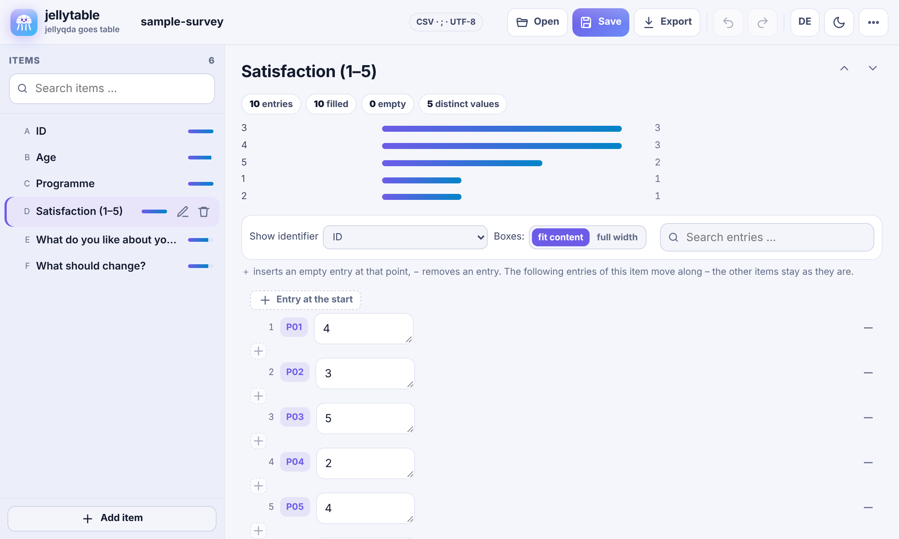
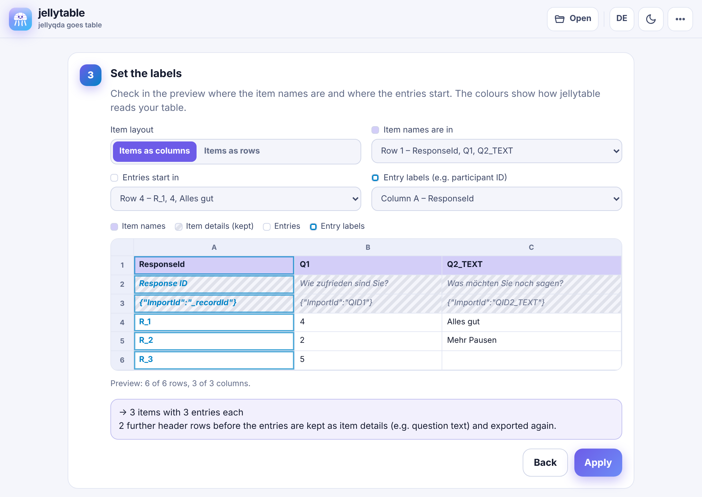

> 🌐 **English** · [Deutsch](README.de.md)


# jellytable

**jellyqda goes table – browse survey tables in peace. Offline, private, in your browser.**

Survey tools export CSV or Excel files that are hard to read: dozens of columns, long free-text answers squeezed into tiny cells. jellytable shows **one item at a time**: the items (questions) on the left, all entries of the selected item on the right – to read, edit and save again.



- 🔒 **Privacy first:** everything happens in your browser tab. No upload, no server, no account, no cookies, no tracking.
- ✈️ **Works offline:** jellytable is **one single HTML file** without libraries. Download it, double-click it, done.
- 🧭 **Items as columns or rows:** you choose how your table is laid out (typical survey export: one column per question, one row per person).
- 🏷️ **You decide where the labels are:** a preview shows which row (or column) holds the item names, where the entries start and which column labels the entries (e.g. participant ID). Extra header rows – such as the question text and import IDs in Qualtrics exports – are kept as *item details* and exported again unchanged.
- 🔎 **Browse:** item list with search and fill level, entries with frequencies for closed questions, an identifier column of your choice (e.g. participant ID) next to each entry, search within entries.
- ↔️ **Comfortable reading:** drag the edge of the item list to make it wider or narrower (remembered); entry boxes grow with their content (or switch to full width).
- ✏️ **Edit:** change entries, **＋** inserts an empty entry anywhere (also at the start and end), **−** removes an entry, rename / add / delete / move items. Undo and redo for everything.
- 💾 **Save & export:** Excel (`.xlsx`), OpenDocument (`.ods`), CSV (comma, UTF-8), CSV for Excel (semicolon, with BOM), TSV, Excel 2003 XML, JSON – as items in columns or rows.
- 🌙 **Light and dark mode**, 🌐 **English and German** interface.

## Use it

- **Online:** open the GitHub Pages site of this repository (see *Publish* below).
- **Offline:** download [`index.html`](index.html) (e.g. *Raw → Save as…*) and open it in your browser. Nothing else is needed.

Then: **1** choose whether your items are columns or rows → **2** drop your file → **3** check the preview and set where the item names, the entries and the entry labels are → browse. You can change step 3 later at any time (⋯ menu → *Layout & labels*).



 **Save** (Ctrl+S) writes the file in its original format; **Export** (Ctrl+E) lets you choose format and layout. In the browser, “saving” means downloading the file – your original file is never changed.

### Supported formats

| | Read | Write |
|---|---|---|
| CSV / TSV / TXT (delimiter and encoding detected: UTF-8, UTF-16, Windows-1252) | ✅ | ✅ |
| Excel `.xlsx` / `.xlsm` (several sheets, dates, booleans) | ✅ | ✅ `.xlsx` |
| OpenDocument `.ods` | ✅ | ✅ |
| Excel 2003 XML (SpreadsheetML) | ✅ | ✅ |
| JSON | – | ✅ |
| Old binary Excel `.xls` | ❌ (save as `.xlsx` first) | – |

Values are written as numbers when they look like plain numbers and as text otherwise; dates are written as text in ISO format (`2026-03-01`). Formulas and formatting of the original file are not kept – jellytable works with the values.

### Keyboard shortcuts

| Keys | Action |
|---|---|
| Ctrl + S | Save |
| Ctrl + E | Export |
| Ctrl + O | Open a file |
| Ctrl + Z / Ctrl + Y | Undo / redo |
| Alt + ↑ / ↓ | Previous / next item |

On a Mac, use Cmd instead of Ctrl.

## Privacy

jellytable never sends data anywhere – there is no server it could send to. Files are read and written in the browser tab. The browser only stores your **settings** (language, light/dark, layout). Your **work** is stored only if you switch on *Remember work in this browser* (off by default; IndexedDB, on this device only). *Delete stored data* in the ⋯ menu removes everything.

## Development

No build tools, no dependencies – only Python 3 to glue the source files together:

```
src/shell.html   page skeleton
src/style.css    look (jellyqda style, light/dark)
src/formats.js   reading/writing CSV, XLSX, ODS, XML (ZIP via the browser’s (De)CompressionStream)
src/i18n.js      German and English texts
src/app.js       the app
build.py         -> index.html (one self-contained file)
```

```bash
python3 build.py
```

`samples/edge-cases.csv` contains quotes, line breaks inside cells, umlauts, emoji and empty cells for testing.

## Publish (GitHub Pages)

The workflow in `.github/workflows/pages.yml` publishes `index.html` on every push to `main`. One-time setup: *Settings → Pages → Source: GitHub Actions*.

## Licence

MIT – see [LICENSE](LICENSE). jellytable is a little sibling of [jellyqda](https://github.com/thedivingshellyfish/jellyqda) 🪼
